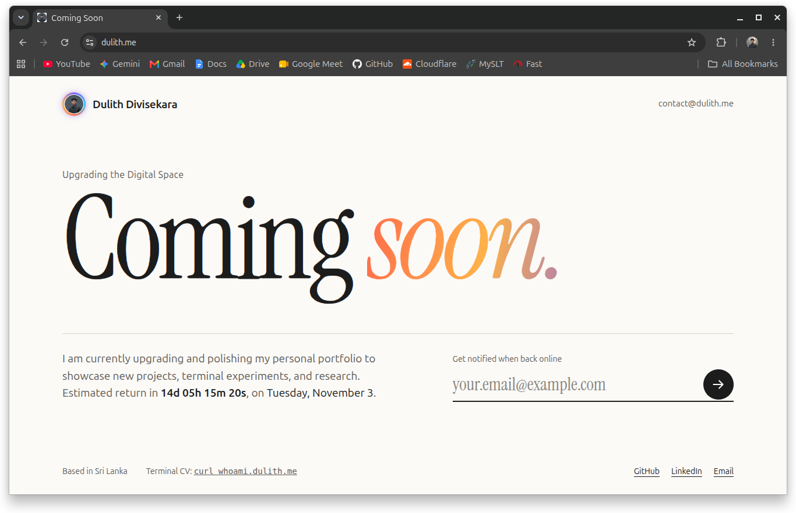
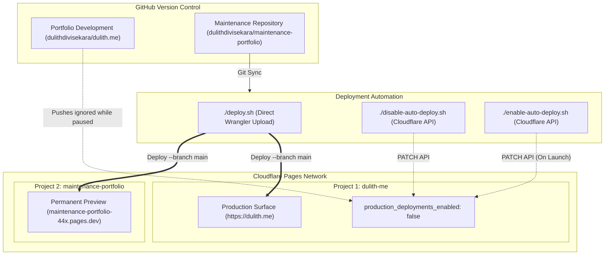

<div align="center">

# 🚧 Maintenance & Coming Soon Portfolio

### *Temporary Holding Page & Decoupled Cloudflare Pages Deployment Pipeline*

[](https://pages.cloudflare.com)
[](https://dulith.me)
[](https://developer.mozilla.org/en-US/docs/Glossary/HTML5)
[](https://developer.mozilla.org/en-US/docs/Web/CSS)
[](https://developer.mozilla.org/en-US/docs/Web/JavaScript)
[](LICENSE)

<br/>

<a href="https://dulith.me" target="_blank">
  
</a>

<p align="center">
  <b>Live Production Surface:</b> <a href="https://dulith.me">https://dulith.me</a>
  
</p>

---

</div>

## 📌 Overview & Architecture

While the primary portfolio application (`dulithdivisekara/dulith.me`) undergoes active overhaul, development commits to `main` must not expose broken layouts or half-finished features to incoming visitors on **`https://dulith.me`**.

Rather than commingling temporary holding assets inside the main repository or risking deployment overwrites on every push, this project establishes a **Decoupled Dual-Project Deployment Architecture**:

1. **Independent Micro-Repository**: Isolates maintenance page code and assets into this dedicated, version-controlled repository.
2. **Git Auto-Deploy Suppression**: Automated Cloudflare Pages build triggers on `dulithdivisekara/dulith.me` are paused via Cloudflare's project configuration API (`production_deployments_enabled: false`).
3. **Dual Cloudflare Deployment Target**:
   * **Active Production Alias**: Deployed directly to the primary domain `https://dulith.me` via the `dulith-me` project.
   * **Permanent Standalone Preview**: Mirror-deployed to [`https://maintenance-portfolio-44x.pages.dev`](https://maintenance-portfolio-44x.pages.dev) for permanent preview, staging, and reusability across future maintenance windows.



---

## ✨ Features

- **⚡ Zero Build Dependencies**: Engineered in pure HTML5, CSS3, and vanilla JavaScript. No framework overhead, no node build steps, and instantaneous global edge delivery.
- **⏱️ Live Dynamic Countdown**: Computes remaining launch time down to the second via `data-days` and `data-hour` attributes.
- **📬 Subscriber Notification Engine**: Client-side validated email capture with instant user feedback, saving leads to `localStorage` (`dulith_notif_subscribers`).
- **🔤 Self-Hosted Typography**: Packaged with local WOFF2 `Instrument Serif` font files, eliminating external Google Fonts render-blocking requests and privacy leaks.
- **🛡️ Hardened Cloudflare Headers**: Includes pre-configured `_headers` enforcing Strict Content Security Policy (CSP), HSTS, and frame-busting rules.
- **💻 Terminal CV Bridge**: Directly features the terminal-based CV integration (`curl whoami.dulith.me`).

---

## 🗂️ Project Structure

```
maintenance-portfolio/
├── assets/
│   └── preview.png          # High-resolution screenshot of the live holding page
├── css/
│   └── style.css            # Minimalist typography and responsive layout styles
├── fonts/                   # Self-hosted Instrument Serif WOFF2 fonts
│   ├── instrument-serif-400-italic-latin-ext.woff2
│   ├── instrument-serif-400-italic-latin.woff2
│   ├── instrument-serif-400-latin-ext.woff2
│   └── instrument-serif-400-latin.woff2
├── js/
│   └── snippet.js           # Countdown ticker and email subscription handler
├── _headers                 # Cloudflare Pages security & caching policy headers
├── deploy.sh                # Direct multi-project deployment via Wrangler CLI
├── disable-auto-deploy.sh   # Pauses automatic Cloudflare git builds on dulith.me
├── enable-auto-deploy.sh    # Resumes automatic Cloudflare git builds on dulith.me
├── index.html               # Semantic holding page markup
├── profile.jpg              # Profile avatar asset
├── LICENSE                  # MIT License
└── README.md                # Project documentation & operational manual
```

---

## 🛠️ Management & Deployment Scripts

### 1. Deploy / Sync the Maintenance Page
Deploys static assets directly to both Cloudflare Pages projects without requiring a remote GitHub Action runner:
```bash
./deploy.sh
```
*Outputs:*
- `dulith-me` ➔ [https://dulith.me](https://dulith.me)
- `maintenance-portfolio` ➔ [https://maintenance-portfolio-44x.pages.dev](https://maintenance-portfolio-44x.pages.dev)

### 2. Pause Automatic Production Deploys
Disables Cloudflare Pages automatic builds triggered by pushes to the `main` branch of the main portfolio repository (`dulithdivisekara/dulith.me`):
```bash
./disable-auto-deploy.sh
```

### 3. Re-enable Automatic Production Deploys (Launch Day)
When the new portfolio is complete and ready to launch, restore automated continuous deployment:
```bash
./enable-auto-deploy.sh
```

---

## 🎨 Customization Guide

### Launch Countdown
Open [`index.html`](index.html#L28) and modify the `data-days` or `data-hour` attributes:
```html
<span class="cl-soon03__timer" data-countdown data-days="14" data-hour="9">
```

### Email Notification Webhook
The subscription form in [`js/snippet.js`](js/snippet.js) caches submitted emails in the browser's `localStorage`. To forward emails to an external endpoint or Cloudflare Worker, insert your endpoint call into the submit listener:
```javascript
fetch('https://api.dulith.me/subscribe', {
  method: 'POST',
  headers: { 'Content-Type': 'application/json' },
  body: JSON.stringify({ email: value })
});
```

### Security Headers
Cloudflare Pages automatically processes the [`_headers`](_headers) file at the project root to enforce security headers across all edge responses.

---

## 📄 License

Distributed under the **MIT License**. See [`LICENSE`](LICENSE) for complete details.

---

<div align="center">
  <sub>Maintained by <a href="https://github.com/dulithdivisekara">Dulith Divisekara</a> &bull; Hosted on Cloudflare Pages</sub>
</div>
